[LinkedIn](https://www.linkedin.com/in/benjamin-diaz-donoso/) · [Repositorios](https://github.com/benjadiaz112?tab=repositories) · [Actividad en GitHub](https://github.com/benjadiaz112#contribution-activity)

Desarrollo aplicaciones web y proyectos de análisis de datos. Me interesa conectar la interfaz, el backend y los datos para construir herramientas que ayuden a gestionar procesos y tomar decisiones. Estudio Ingeniería en Informática con mención en Ciencia de Datos en Duoc UC. Busco oportunidades junior, colaboraciones freelance y proyectos remotos en software y datos.

Ver tecnologías y herramientas

| Área | Tecnologías y conocimientos |
| --- | --- |
| Lenguajes | Python, JavaScript, TypeScript, Java, Kotlin, SQL y Solidity |
| Frontend | React, Next.js, HTML5, CSS3, Tailwind CSS y Vite |
| Backend e integración | Node.js, Spring Boot, FastAPI y APIs REST |
| Móvil | Android Studio, Kotlin, Firebase Authentication y Cloud Firestore |
| Datos SQL, NoSQL y vectoriales | PostgreSQL, Supabase, MongoDB, Firebase, Cloud Firestore y Pinecone |
| Análisis y Machine Learning | pandas, NumPy, scikit-learn, análisis exploratorio, regresión, clustering, K-Means, PCA, HistGradientBoosting, ensambles, ajuste de hiperparámetros y validación cruzada agrupada |
| Visualización y plataformas de datos | Streamlit, Plotly, D3.js, Matplotlib, Seaborn, Power BI, Databricks, Jupyter Notebook y Google Colab |
| Cloud y colaboración | Azure, Docker, Git, GitHub, GitHub Actions, pull requests y revisión de código |
| Seguridad y blockchain | Ciberseguridad, auditoría, protección de datos personales, expresiones regulares, Solidity, Remix IDE, contratos inteligentes y DApps |
| Metodologías | Scrum y CRISP-DM |

- **Machine Learning.** Preparación de datos, regresión, segmentación y evaluación de modelos en [Spotify Tracks](https://github.com/benjadiaz112/spotify-tracks-eda).
- **IA generativa y automatización.** Desarrollo Vexum, una iniciativa de software, automatización e IA. Mi formación incluye IA generativa y mi stack de datos incluye Pinecone como base vectorial.
- **Seguridad en aplicaciones de IA.** En [DELIA](https://github.com/andres-olguin/DELIA) contribuí al enmascaramiento de identificadores de México y Bolivia, con validaciones y pruebas. También trabajé en benchmarks y reproducibilidad. [Cambio integrado](https://github.com/andres-olguin/DELIA/pull/20) · [Propuesta de CI](https://github.com/andres-olguin/DELIA/pull/67)

Ver proyectos, detalles y repositorios

| Proyecto | Qué hace |
| --- | --- |
| [Spotify Tracks](https://github.com/benjadiaz112/spotify-tracks-eda) | Análisis y estimación de popularidad musical con regresión, segmentación y validación cruzada agrupada. |
| **Ryde** | Plataforma web para una marca de ropa con interfaz, backend, persistencia y panel de administración. Repositorio privado. |
| [Frontend para clínica dental y facial](https://github.com/benjadiaz112/frontend-clinica-dental-facial) | Catálogo de tratamientos y reserva de demostración con una API simulada, validaciones y pruebas. |
| [Trazabilidad de fruta](https://github.com/benjadiaz112/trazabilidad-fruta-dapp) | DApp que registra estados de un cargamento y simula alertas de temperatura con un contrato inteligente y un oráculo. |
| [StreamView Analytics](https://github.com/fluzxks/StreamView_project_exp2) | Dashboards ejecutivo y analítico con filtros, mapas, comparación de títulos y visualizaciones interactivas. |
| **Viemms Store** | App Android con autenticación, perfiles de cliente y administrador, y gestión de productos en Firestore. Repositorio privado. |
| **Vexum** | Landing page de una iniciativa de diseño, desarrollo web, automatización e IA. Repositorio privado. |
| **Security Auditor & Licensing System** | Auditoría de seguridad y gestión de licencias orientada al cumplimiento en equipos finales. |
| [AegisBot](https://github.com/andres-olguin/AegisBot/pull/21) | Contribución para validar confirmaciones y detener sesiones ante fallos, con pruebas de regresión. |

[Resultados de Spotify Tracks](https://github.com/benjadiaz112/spotify-tracks-eda/tree/feat/spotify-ep3) · [StreamView Analytics](https://github.com/fluzxks/StreamView_project_exp2)

## Formación y certificaciones

**Ingeniería en Informática, mención Ciencia de Datos — Duoc UC**  
En curso · Sexto semestre

- Usando la IA Generativa — Duoc UC, 36 horas, 2026.
- Ethical Hacking Professional Certification (CEHPC) — CertiProf, 2026.
- Cyber Security Foundation Professional Certificate (CSFPC) — CertiProf, 2026.
- Cybersecurity Awareness Professional Certification (CAPC) — CertiProf, 2026.
- Microsoft Certified Azure Fundamentals (AZ-900) — Microsoft, 2026.
- Formación complementaria en NoSQL y modelado de documentos con MongoDB.

Para oportunidades de desarrollo, datos o colaboración por proyecto, escríbeme por [LinkedIn](https://www.linkedin.com/in/benjamin-diaz-donoso/).
